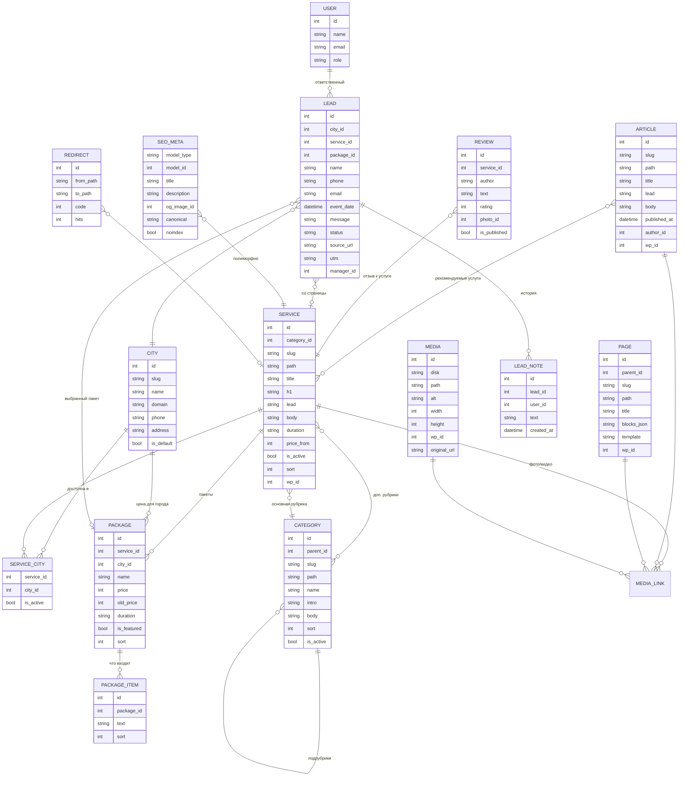

# Счастье-events: анализ базы и схема нового сайта

Источник: дамп `schastme_wp1.sql` (phpMyAdmin, хостинг Beget, MySQL 5.7, PHP 5.6), снят **22.04.2025**.
Сверка: выдача Google `site:schastie-events.com` на ноябрь 2026.
Карта всех URL из базы лежит рядом: [`url-map.csv`](url-map.csv) (297 адресов с SEO-заголовками и описаниями).

---

## 1. Что было на сайте

| Параметр | Значение |
|---|---|
| CMS | WordPress, тема Twenty Seventeen, все страницы собраны в **Elementor Pro** |
| Плагины | Elementor + Elementor Pro, Yoast SEO Premium, WP Rocket, Content Views (+Pro), The Post Grid, Code Snippets Extended. В базе также остались таблицы WooCommerce, Redirection, EWWW, Smush |
| ЧПУ | `/%category%/%postname%/` у записей, иерархия у страниц |
| Название | Агентство «СЧАСТЬЕ – EVENTS». Организация свиданий, сюрпризов и праздников в Санкт-Петербурге |
| Пользователи | 2: `valentina` (с 2018 г.) и `Marina` (с 2022 г.) |

### Контент

| Тип | Кол-во | Что это |
|---|---|---|
| Записи (`post`) | 229 опубл. + 4 черновика | услуги и статьи «Счастье в мелочах» |
| Страницы (`page`) | 68 опубл. + 3 черновика | главная, разделы, свадьбы, праздники, «Личный блог» |
| Медиафайлы | 2 424 картинки | **сами файлы в дампе отсутствуют**, только ссылки на них |
| Шаблоны Elementor | 356 | секции, хедер и футер, попапы |
| Ревизии | 8 365 | мусор, не переносим |
| Заявки с форм | 923 | 04.2022 – 04.2025, имя / e-mail / телефон / сообщение |
| Редиректы (Redirection) | 870 | почти все ведут на `/uslugi-i-tseny/` |
| Пакеты с ценами | **458 пакетов на 161 странице** | от 2 000 до 645 000 ₽ |
| SEO (Yoast) | у 302 объектов заданы title и description | переносим 1:1 |
| Заказы WooCommerce | 2 (1 товар «Мужские букеты») | магазин фактически не использовался |

### Разделы (рубрики)

```
Услуги и цены            /uslugi-i-tseny/
├── Сюрпризы             /uslugi-i-tseny/syurprizy/…          61 услуга
└── Подарки              /uslugi-i-tseny/podarki/…            25
Романтические свидания   /romanticheskie-svidaniya/…          50
Организация праздников   /organizatsiya-prazdnikov/…
├── День рождения        …/den-rozhdeniya/…                   10
├── Свадьба
│   ├── Свадьба для двоих  …/svadba/svadba-dlya-dvoih/…       10
│   └── Свадьба под ключ   …/svadba/svadba-pod-kluch/…         5
├── Детский праздник, Новогодние, Девичник                     7
Мастер-классы            /master-klassi/…                      1
Счастье в мелочах (блог) /schastye-v-melochakh/…              60
```

Отдельно есть **страницы** с собственной иерархией:
`/uslugi-i-tseny/` → `syurprizy`, `podarki`, `organizatsiya-prazdnikov` (день рождения, 14 февраля, 23 февраля, 8 марта, детские, новогодние, девичник, мальчишник), `predlozheniya-ruki-i-serdtsa`, `vstrecha-iz-roddoma`, `svadba-mechty` (для двоих, с гостями, выездная регистрация, под ключ), `godovshchina-svadby`, `primireniye`, `kviz`. Кроме того, есть `/lichnyy-blog/` (30 статей-страниц), `/o-nas/`, `/portfolio/`, `/otzyvy/`, `/kontakty/`, `/franshiza/`, `/master-klassi/`.

### Как устроена страница услуги (Elementor)

```
хлебные крошки → заголовок → карусель фото (×2)
пакет: название → цена → список «✔ …» → «Продолжительность: …» → кнопка «Заказать»   (×N)
якорь «Забронировать дату» → форма (имя, телефон/e-mail, дата, сообщение)
SEO-текст
```

Сейчас всё это лежит вёрсткой в JSON Elementor. В новой системе это будут **поля** услуги и **связанные пакеты**, которые менеджер редактирует в админке без вёрстки.

---

## 2. Проблемы, которые надо решить

1. **Нет картинок.** В дампе только пути `wp-content/uploads/2018/07/…`. Файлы нужно найти: бэкап хостинга (Beget хранит копии), локальные копии у клиента, Web Archive или Google Images. Это **главный блокер** восстановления.
2. **Дамп отстаёт на ~1,5 года.** В Google есть статьи, которых нет в базе (например, `podarki-na-8-marta-2026-…`, `podarki-na-23-fevralya-myzhinam-…`, `5-idei-kak-sdelat-predlozhenie-s-arendoi-yahti-spb`). Их тексты придётся восстановить из Web Archive или кеша поисковиков.
3. **Москвы нет в этом дампе.** `msk.schastie-events.com` — отдельная установка WordPress, в этой базе на неё только 40 ссылок. Нужна её база или решение собрать Москву заново.
4. **Дубли.** Услуги существуют и как страницы, и как записи, например свадьбы (`/uslugi-i-tseny/svadba-mechty/…` против `/organizatsiya-prazdnikov/svadba/…`) и разделы-страницы против рубрик. Также 870 редиректов, многие из них мусорные (`…/mishka-teddi/ПАКЕТ "ЛЮКС`).
5. **Заявки без структуры.** Поля формы называются случайными ID Elementor (`d57a60b`, `bdfae3b`…), на сайте 269 копий формы. Статусов и ответственных нет.
6. **Безопасность.** В логах 404 видно, что сайт сканировали в поисках веб-шеллов (`alfa.php`, `wso.php`, `seotheme/mar.php`). Старый код и плагины не переносим, берём только контент.
7. **Персональные данные.** 923 заявки содержат имена, телефоны и e-mail клиентов. **В git они не попадают**, только в базу нового сайта.

---

## 3. Новая архитектура

**Стек** (как в k-truck): Laravel 13 + Filament 5 (админка) + Blade (публичный сайт), MySQL/MariaDB, хранилище картинок в `storage` с генерацией WebP.

### Принципы
- **URL сохраняются 1:1.** Каждая сущность хранит полный `path`, а маршрутизатор ищет по нему. Тогда старые адреса и позиции в выдаче не теряются.
- **Один город — одна строка в `cities`.** СПб и Москва в одной админке, поддомен определяет город. Услуга может быть в обоих городах со своими ценами.
- **Услуга — это данные, а не вёрстка.** Пакеты, цены, фото, что входит, длительность — всё это поля. Блоки страницы (тексты, FAQ, галерея) собираются из готовых секций.
- **Заявки — мини-CRM.** Статус, источник (страница, пакет, UTM), ответственный, комментарии.

### Схема данных



### Админка (Filament)

| Раздел | Что делает | Кто |
|---|---|---|
| **Заявки** | список с фильтрами (город, статус, услуга, дата), карточка с историей, смена статуса (новая → в работе → согласовано → оплачено → проведено / отказ), назначение менеджера, уведомления в Telegram и на почту | менеджер |
| **Услуги** | карточка: рубрика, города, фото (drag-n-drop, сортировка), пакеты с ценами и пунктами «что входит», длительность, тексты, SEO; кнопки «скопировать в Москву» и «предпросмотр» | контент-менеджер |
| **Рубрики** | дерево с перетаскиванием, вводный текст, SEO | контент-менеджер |
| **Статьи (блог)** | редактор, обложка, рекомендуемые услуги внизу статьи | контент-менеджер |
| **Страницы** | О нас, Контакты, Франшиза, Портфолио: собираются из блоков (текст, галерея, FAQ, CTA, форма, сетка услуг) | контент-менеджер |
| **Отзывы** | модерация, привязка к услуге | менеджер |
| **Медиатека** | все фото, alt-тексты, поиск «где используется» | контент-менеджер |
| **Редиректы** | 301/302, счётчик переходов, журнал 404 с кнопкой «создать редирект» | админ |
| **Города** | телефоны, адреса, мессенджеры для СПб и Москвы | админ |
| **Пользователи и роли** | админ / менеджер / контент-менеджер | админ |
| **Дашборд** | заявки за период по услугам и источникам, конверсия по статусам | все |

### Публичный сайт

```
/                               главная (город по домену)
/{path категории}/              список услуг рубрики с фильтром по цене
/{path категории}/{slug}/       услуга: галерея, пакеты, форма заявки с выбранным пакетом
/schastye-v-melochakh/{slug}/   статья
/lichnyy-blog/{slug}/           статья (старый формат, переносим в ту же таблицу, путь сохраняем)
/{path страницы}/               страница из блоков
/sitemap.xml, /robots.txt       генерируются автоматически
```

Маршрут: `GET /{path?}` → поиск в `services.path`, `categories.path`, `articles.path`, `pages.path` → затем в `redirects` → иначе 404 с записью в журнал.

---

## 4. План восстановления

| Шаг | Что делаем | Результат |
|---|---|---|
| 0 | **Найти картинки:** бэкап Beget, у клиента, в Web Archive | папка `uploads` |
| 1 | Каркас Laravel + Filament, модели и миграции по схеме выше | пустая админка |
| 2 | **Импорт из дампа:** рубрики, услуги с разбором Elementor на пакеты и пункты, статьи, страницы, SEO Yoast, медиа, заявки, чистые редиректы | контент в новой базе |
| 3 | Догрузить статьи после 04.2025 из Web Archive и кеша по списку из Google | полный контент |
| 4 | Вёрстка публичной части (адаптив) | сайт |
| 5 | Сверка: каждый URL из `url-map.csv` и из выдачи Google отдаёт 200 или 301 | без потерь в SEO |
| 6 | Москва: импорт из второго дампа или копирование услуг с московскими ценами | msk.schastie-events.com |
| 7 | Деплой, sitemap в Яндекс Вебмастер и Google Search Console, переобход | сайт в индексе |

## 5. Вопросы к клиенту

1. Есть ли бэкап файлов сайта (`wp-content/uploads`) на Beget или у кого-то на компьютере?
2. Есть ли база сайта msk.schastie-events.com?
3. Нужны ли разделы «Франшиза», «Мастер-классы» и «Квиз»?
4. Куда слать заявки: Telegram, почта (сейчас `schastie-events@mail.ru`), amoCRM или Bitrix24?
5. Нужна ли онлайн-оплата или предоплата на сайте? Сейчас её нет.
6. Где будет хостинг? Нужны PHP 8.3+ и MySQL 8 / MariaDB 10.6+.
