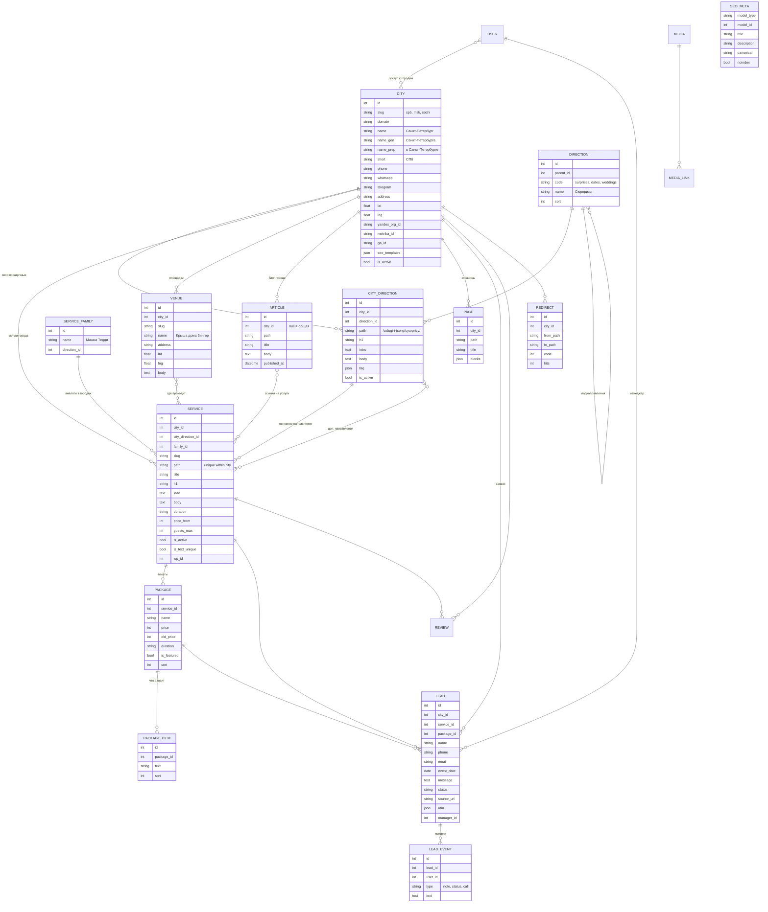

# Счастье-events: три города, свои услуги, региональное SEO

Дополняет [01-analiz-bazy-i-skhema.md](01-analiz-bazy-i-skhema.md). Там схема была с общей услугой и ценами по городам. **Здесь логика другая:** у каждого города свой набор услуг, и именно её мы берём в работу.

---

## 1. Главные решения

| # | Решение | Почему |
|---|---|---|
| 1 | **Каждый город на своём поддомене:** `schastie-events.com` (СПб), `msk.schastie-events.com`, `sochi.schastie-events.com` | В Яндекс Вебмастере регион присваивается сайту целиком, а поддомен считается отдельным сайтом. Получаем три сайта: СПб, Москва и Сочи. СПб остаётся на основном домене, поэтому его позиции не теряются. msk уже в индексе |
| 2 | **Услуга принадлежит одному городу** (`services.city_id`) | В каждом городе свои площадки, подрядчики, цены и тексты. Одна общая запись с тремя ценами дала бы дубли текста на трёх сайтах |
| 3 | **Направления общие, посадочные страницы — свои для каждого города** | Направления «Сюрпризы, Свидания, Свадьбы…» одинаковы, так что их легко сравнивать в отчётах. Но у каждого города своя страница направления: свой H1, текст и SEO («Романтические свидания в Сочи») |
| 4 | **Аналоги связаны через «семейство услуг»** (`service_families`) | «Мишка Тедди» в СПб и в Москве — разные записи с разными текстами, но система знает, что это одно и то же. Это нужно для копирования, отчётов и переключателя города |
| 5 | **Площадки — отдельная сущность города** (`venues`) | Замок БИП, крыша «Зингер», планетарий… На страницах площадок собираются запросы вида «свидание на крыше СПб», и одна площадка подходит для разных услуг |
| 6 | **Город по домену, а не по cookie** | Поисковик видит один и тот же контент по одному URL. Никакой подмены контента по IP |
| 7 | **Админка: город — это «арендатор» (tenant) в Filament** | Менеджер Сочи видит только услуги и заявки Сочи. Админ переключается между городами |

---

## 2. Как устроены данные



### Направления (общие для всех городов)

| code | Направление | Поднаправления (пример) |
|---|---|---|
| `surprises` | Сюрпризы | доставка с актёром, музыкальные, шоу, оформление |
| `gifts` | Подарки | букеты, корзины, мишки |
| `dates` | Романтические свидания | на крыше, на воде, в небе, в замке, ужин |
| `proposals` | Предложение руки и сердца | — |
| `weddings` | Свадьбы | для двоих, под ключ, выездная регистрация |
| `celebrations` | Праздники | день рождения, детские, девичник, мальчишник, Новый год, 14 февраля, 23 февраля, 8 марта |
| `maternity` | Встреча из роддома | — |
| `anniversary` | Годовщина свадьбы | — |

В админке у каждого города переключатели: какие направления там включены. **Направление без активных услуг в городе не показывается и не попадает в sitemap этого города.** Так в Сочи не будет пустой страницы «Свадьбы», если свадеб там нет.

### Пример: одно семейство в трёх городах

| Семейство | СПб | Москва | Сочи |
|---|---|---|---|
| Свидание на крыше | `/romanticheskie-svidaniya/svidaniye-na-kryshe-doma-zinger/` («Зингер», 3 пакета) | `/romanticheskie-svidaniya/svidanie-na-kryshe-moskva-siti/` | нет |
| Свидание на яхте | `/romanticheskie-svidaniya/romanticheskoye-svidaniye-na-italyanskom-korablike/` | своя страница | `/romanticheskie-svidaniya/svidanie-na-yahte-v-more/` (своя, морская) |
| Мишка Тедди | `/uslugi-i-tseny/syurprizy/mishka-teddi/` | своя страница | своя страница |

Тексты, фото, пакеты и цены у каждой записи свои. Общего у них только `family_id`.

---

## 3. Региональное SEO

### Структура сайтов

| | СПб | Москва | Сочи |
|---|---|---|---|
| Домен | schastie-events.com | msk.schastie-events.com | sochi.schastie-events.com |
| Регион в Яндекс Вебмастере | Санкт-Петербург | Москва | Сочи |
| Яндекс Бизнес / Google Business | своя карточка | своя карточка | своя карточка |
| Метрика | свой счётчик | свой счётчик | свой счётчик |
| sitemap.xml, robots.txt | свои | свои | свои |

URL внутри каждого города строятся по тем же правилам, что на старом сайте (`/uslugi-i-tseny/syurprizy/{slug}/`, `/romanticheskie-svidaniya/{slug}/`…). Старые адреса СПб и Москвы сохраняются без редиректов, Сочи строится по той же схеме.

### Что делает система автоматически

1. **Шаблоны title/description с падежами города.** Если менеджер не задал SEO вручную, подставляется шаблон:
   `{h1} {city.name_prep} — от {price_from} ₽ | Счастье-events`
   → «Свидание на яхте в Сочи — от 18 000 ₽ | Счастье-events»
2. **Микроразметка Schema.org для каждого города:** `LocalBusiness` (адрес, телефон, гео, часы), `Service` + `Offer` у каждого пакета, `BreadcrumbList`, `Review`/`AggregateRating`, `FAQPage`.
3. **Защита от дублей между городами.**
   - При копировании услуги в другой город копия создаётся **выключенной** и с флагом `is_text_unique = false`.
   - Пока текст не переписан, страница отдаёт `noindex` и в sitemap не попадает.
   - В админке есть счётчик «неуникальных услуг» по городу.
4. **Canonical всегда указывает на себя.** Ссылок canonical на другой город нет: сайты разные.
5. **Переключатель города в шапке** ведёт на аналог из того же семейства, если он есть, иначе на главную города. Обычная ссылка без автоматического перенаправления.
6. **Блог.** Статья может быть привязана к городу (`city_id`) или быть общей. Общая статья живёт на основном домене, а на поддоменах её нет, чтобы не плодить дубли. Блок «Услуги по теме» внутри статьи показывает услуги того города, где открыта страница.
7. **Площадки** (`/mesta/{slug}/`) — дополнительные посадочные под запросы «где провести свидание {в городе}».

---

## 4. Админка (Filament): мультигород

```
┌ Город: [ Санкт-Петербург ▾ ]      ← переключатель (tenant), у менеджера только свои города
├ Дашборд            заявки города, конверсия, топ услуг
├ Заявки             только этого города
├ Услуги             список: направление, цена от, пакеты, уникальность текста, активность
│   └ Карточка услуги: основное → пакеты → фото → площадки → SEO → «Скопировать в город…»
├ Направления города включено/выключено, H1, текст, FAQ, SEO для этого города
├ Площадки
├ Статьи
├ Страницы           главная, о нас, контакты — свои у каждого города
├ Отзывы
├ Редиректы / 404    свои у каждого поддомена
└ Настройки города   телефон, мессенджеры, адрес, падежи, счётчики, SEO-шаблоны
Общие (только админ):
├ Направления        справочник для всех городов
├ Семейства услуг    группы аналогов, сводная таблица «есть / нет» по городам
├ Медиатека
└ Пользователи       роль + список городов
```

### Роли

| Роль | Права |
|---|---|
| Админ | всё, все города |
| Руководитель города | всё внутри своих городов |
| Контент-менеджер | услуги, статьи, страницы, SEO в своих городах; заявки не видит |
| Менеджер по заявкам | заявки своих городов, отзывы |

### Таблица «Семейства × Города»

| Семейство | СПб | Москва | Сочи |
|---|---|---|---|
| Мишка Тедди | ✅ 3 пакета, от 9 500 | ✅ от 9 000 | ⚠️ копия, текст не уникален |
| Свидание на крыше | ✅ | ✅ | — [создать] |

Здесь сразу видно, чего не хватает в каждом городе, и аналог можно создать в один клик.

---

## 5. Заявки

- Город заявки определяется по домену формы, менеджеры назначаются по городу.
- Уведомление уходит в Telegram-чат **города**: в каждом городе свои исполнители.
- В карточке заявки сохраняется услуга, пакет на момент заявки (название и цена), URL страницы, UTM и Яндекс ClientID.
- Статусы: новая → в работе → согласовано → предоплата → проведено / отказ (с причиной).

---

## 6. Перенос старых данных

| Откуда | Куда |
|---|---|
| Дамп СПб (этот) | `city = spb`: рубрики → направления СПб, записи-услуги → `services` + `packages`, статьи → `articles (city=spb)` |
| Дамп Москвы (нужен) | `city = msk`, так же |
| Сочи | новый город, наполняем с нуля, часть услуг через «Скопировать из СПб» с обязательной уникализацией |
| Услуги-дубли «страница + запись» | одна услуга, второй адрес 301 → на неё |
| Аналоги СПб и Москвы | автоматически объединяются в семейства по похожим slug и заголовкам, потом проверяются вручную |

---

## 7. Открытые вопросы

1. Домен для Сочи: `sochi.schastie-events.com` или отдельный домен?
2. Есть ли в Сочи свой офис или адрес для карточек Яндекс Бизнес и Google?
3. Список услуг для Сочи хотя бы черновиком: море, яхты, горы (Красная Поляна)?
4. Общий телефон 8-800 или свой номер в каждом городе (лучше для локального SEO)?
5. Кто будет вести заявки в каждом городе: один отдел или разные люди?
